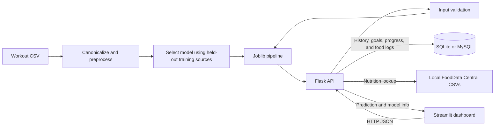

# FitPredict AI — IACES

FitPredict AI is an end-to-end machine-learning application for workout calorie estimation and fitness progress tracking. A Streamlit dashboard sends validated requests to a Flask API, which calls a saved Scikit-learn pipeline. SQLite or MySQL stores workout history, goal profiles, dated progress entries, and food logs. The app also exposes model evaluation metrics and global feature importance for transparency.

The workout model was trained on three CSVs with 19,837 sessions. It estimates 8.44 kcal per minute of workout duration. The duration-only model had the lowest average error when each dataset counted equally in model selection. Users with the same workout duration receive the same estimate. Errors vary substantially by dataset.

## Deploy the portfolio demo on Render

1. Sign in to Render and open [Deploy IACES](https://render.com/deploy?repo=https%3A%2F%2Fgithub.com%2Fmadhu2003-2%2FIACES).
2. Choose your workspace. If prompted, connect GitHub and select `madhu2003-2/IACES`, branch `main`. Use the root `render.yaml` and give the Blueprint a name such as `iaces`.
3. Review the single **Free** web service, `iaces-fitpredict`, and click **Deploy Blueprint**. The configuration supplies the Python version and build and start commands.
4. Open the service, wait for **Live**, and click the displayed `onrender.com` URL. This is the link to share. If a build fails, open the deploy log to see the first error.
5. In **Predict calories**, leave the workout duration at **45 minutes** and click **Predict calories**. The bundled model should return **379.88 kcal**. Save a goal with a nickname to try daily check-ins and the food log, then open **Workout history** to see the entries.

The public URL serves Streamlit. Flask runs privately inside the same service. Each browser session gets a separate temporary SQLite database. Download your progress CSV before closing or refreshing the tab. The local two-window workflow below continues to support persistent SQLite or MySQL history.

The build installs dependencies from `uv.lock` and downloads four verified nutrition tables from the [USDA FNDDS October 2024 release](https://fdc.nal.usda.gov/download-datasets/). The 739-byte fitted workout model and its evaluation metadata ship in `deploy/`; the training datasets, personal logs and Windows virtual environment stay local. The experimental fitness assessment endpoint is part of the local API.

Free services can sleep after 15 minutes of inactivity. A later visit can take about a minute to wake the app. [Render free-service details](https://render.com/docs/free)

## Running a fresh clone

From a PowerShell window, clone the repository and enter its folder:

```powershell
git clone https://github.com/madhu2003-2/IACES.git
Set-Location IACES
uv sync
Copy-Item .env.example .env
```

The public repository contains source code, the database schema, a Postman collection, aggregate evaluation results and the fitted demo calorie model. To train your own local predictor, place compatible workout CSVs in `data/processed/` and run the training and evaluation commands below. To serve the bundled predictor locally, set `FITPREDICT_MODEL_PATH=deploy/workout.joblib` and `FITPREDICT_MANIFEST_PATH=deploy/workout_manifest.json` in your local `.env`. For food search, run `uv run python deploy/prepare_food.py` or install the reference files described below.

## What is in this project

- `data/processed/`: workout datasets and additional research files. Training automatically selects CSVs whose columns match the workout-calorie schema and skips unrelated CSVs.
- `notebooks/eda_and_model_experiment.ipynb`: optional dataset inspection and charts; it does not train a model.
- `src/iaces/ml/`: column normalization, multi-source model training, source-aware evaluation, and reporting commands.
- `src/iaces/api/`: Flask endpoints for health, calorie predictions, food search/logging, workout history, goal profiles, and progress entries.
- `src/iaces/nutrition.py`: local FoodData Central search and per-portion calorie/protein estimates.
- `frontend/streamlit_app.py`: dashboard for calorie prediction, nutrition logging, workout analytics, workout history, and goal progress tracking.
- `database/schema.sql`: MySQL tables for user names, workout history, goal profiles, progress entries, and food logs. SQLite creates its tables automatically.
- `postman/FitPredict_API_Collection.json`: requests and response assertions for manual API checks.
- `docs/api_reference.md`: endpoint and payload documentation.
- `docs/model_card.md`: evaluation protocol, measured results, intended use, and limitations.
- `docs/nutrition_model_card.md`: separate FNDDS nutrition-model results and limits.
- `docs/data_provenance.md`: dataset attribution and licensing notes.
- `docs/resume.md`: accurate project bullets you can adapt for your resume.
- `reports/`: generated metrics and comparison files appear here after you run training/evaluation.

## Architecture



## Dataset choice and limits

The three local files contain 19,837 rows total. Their schemas can be normalized to the app's shared inputs—gender, age, weight, workout duration, and heart rate—and calorie target. The training code converts `Session_Duration (hours)` to minutes and leaves unrelated columns out of the current model. It records source row counts, file hashes, and source columns in the training manifest.

The sources have notably different duration and calorie distributions, and local source and license metadata are missing. Multi-file training therefore uses leave-one-dataset-out evaluation: it trains and tunes on the other selected files, then scores the excluded file. This measures transfer between these files; it does not verify that their labels were collected the same way or establish performance on new people or devices. Confirm source and license details before redistributing the data or making performance claims. See [data provenance notes](docs/data_provenance.md). The app does not present estimates as medical measurements.

The nested FoodData Central survey export is a nutrition reference catalog, not a workout-model training dataset. Leave the four CSV tables together in their downloaded folder under `data/processed/` (or `data/raw/`); the API discovers them on the first food search. The app reads `food.csv`, `food_nutrient.csv`, `food_portion.csv`, and `nutrient.csv` to search foods and estimate calories and protein for logged gram amounts or listed serving sizes. The calorie estimate uses nutrient number 208 and protein uses nutrient number 203, both per 100 g edible portion. This lookup does not predict daily nutrition needs or goal completion time. To train the workout model, run the training command above on compatible workout calorie CSVs; the FoodData Central folder is not used as a training input.

### Train a separate FNDDS nutrition model

FNDDS can also train a separate experimental model to estimate **calories and protein per 100 g** from a food's description and category. It does not train the workout-calorie or weight-goal model. The script holds out identical normalized food descriptions together, compares against a category-median baseline, and writes its model and metrics separately so it cannot replace the workout model:

```powershell
.\.venv\Scripts\python.exe -m iaces.ml.train_nutrition_model --data-dir ".\data\processed\FoodData_Central_survey_food_csv_2024-10-31\FoodData_Central_survey_food_csv_2024-10-31"
```

The artifact is saved to `models/fndds_nutrition_estimator.joblib`; evaluation and holdout predictions go to `reports/fndds_nutrition/`. The run used 5,431 foods with both targets and held out 1,087 descriptions. On that holdout, energy predictions scored MAE 41.93 kcal/100 g, RMSE 63.26, R² 0.8009; protein scored MAE 2.21 g/100 g, RMSE 3.51, R² 0.7883. The text model's RMSE/R² beat a category-median baseline, while its MAE was slightly worse for both targets. The food logger continues to use recorded catalog values when an exact food is available, because those are the source labels rather than estimates from the text model. See [nutrition model card](docs/nutrition_model_card.md).

## Current evaluation snapshot

Each workout CSV was held out in turn. The training procedure selected its model using only the other files. MAE is the average absolute difference between an estimate and the recorded calorie value. Lower is better.

| Held-out sessions | New selection procedure MAE | Fixed duration-only model MAE |
|---|---:|---:|---:|
| All 19,837 sessions | 83.07 kcal | 89.56 kcal |
| 15,000 short workouts | 36.26 kcal | 55.05 kcal |
| 3,864 exercise records |  182.74 kcal | 143.11 kcal |
| 973 gym sessions | 408.91 kcal | 408.91 kcal |

The selection procedure reduced pooled MAE by 64.9%. The final fit selected the duration-only model. Its error averaged over the three files with equal weight was 202.35 kcal. The large gym-session error and unverified label definitions limit individual use. These are development benchmarks on the same three files used to improve the project. See [the model card](docs/model_card.md) for the baselines and limitations.

## 1. Install dependencies

Open PowerShell and run:

```powershell
uv sync
Copy-Item .env.example .env
```

`uv sync` installs the project and its dependencies into the project environment. You can run the commands below with `uv run`; a separate activation step is not needed.

## 2. Inspect the dataset (optional)

Open `notebooks/eda_and_model_experiment.ipynb` in Jupyter or VS Code and run the inspection cells yourself. They display schema, missing values, duplicates, summary statistics, distributions, and correlations. The notebook does not fit or evaluate models.

## 3. Train and compare models

By default, training reads compatible workout-calorie CSV files from `data/processed`:

```powershell
uv run python -m iaces.ml.train_model
```

The trainer skips files without the workout-calorie schema. For each excluded dataset, it compares a training-median baseline, a duration-only model, a duration-and-heart-rate model, linear regression, decision tree, gradient boosting and a tuned Random Forest. It chooses the candidate with the lowest average validation MAE on the remaining files, then scores that choice on the excluded file. The final fit repeats selection on all sources and saves the winner to `models/calorie_prediction_pipeline.joblib`. The fold choices, predictions and source hashes are saved in `reports/`.

To train on just one CSV and retain the original random holdout workflow, pass its path:

```powershell
uv run python -m iaces.ml.train_model --data .\data\processed\calories.csv
```

You can also pass an explicit list after `--data`. Each file must have equivalent gender, age, weight, duration, heart-rate, and calorie columns. `Session_Duration (hours)` is converted to minutes; missing required columns are reported instead of guessed.

## 4. Evaluate the holdout predictions

After training, run:

```powershell
uv run python -m iaces.ml.evaluate_model --predictions .\reports\model_holdout_predictions.csv
```

This reports MAE, MSE, RMSE, and R² overall and by held-out dataset into `reports/model_metrics.json`, `reports/model_comparison.csv`, and `reports/model_source_comparison.csv`. These are measured results from your run; do not replace them with example numbers.

## 5. Start the API and dashboard

Use two PowerShell windows, both in the cloned project folder. `uv run` selects the project environment.

Window 1 — Flask API:

```powershell
uv run python -m iaces.api.app
```

The default address is `http://127.0.0.1:5000`. Check `GET /health`. Before training, the API reports that the model is unavailable; after training it reports `model_available: true`.

Window 2 — Streamlit dashboard:

```powershell
uv run streamlit run .\frontend\streamlit_app.py
```

The dashboard calls the Flask API and does not load the model directly. Set `FITPREDICT_API_URL` in `.env` if the API runs at a different address.

## 6. Enable workout history (optional)

For local use, SQLite is the easiest option and does not require a database server. In `.env`, set:

```dotenv
DATABASE_ENABLED=true
DATABASE_BACKEND=sqlite
DATABASE_PATH=database/fitpredict_history.sqlite3
```

Restart the Flask API. The SQLite file and tables are created automatically when the API first saves or loads workout history. Make a new prediction, then open the dashboard's **Workout history** tab and select **Load workout history**. Predictions made while history was disabled were not stored.

Workout history shows separate goal profile, daily check-in, food, and workout prediction logs. Named entries use the same profile ID; unnamed workout predictions have no profile ID. Saving a goal adds a snapshot to the goal log. Existing profiles receive one initial snapshot when the updated app first connects to the database. Previous overwritten goal versions cannot be recovered. Check-ins and foods are linked to the profile, not to a particular version of a goal; manually entered nutrition and food-log estimates remain separate.

For MySQL, the goal save and linked history features create and backfill `goal_profile_log` if needed. The database account needs permission to create the table on first use, or an administrator can apply the updated `database/schema.sql` first. SQLite creates it automatically.

MySQL remains supported. Set `DATABASE_BACKEND=mysql`, configure `DB_HOST`, `DB_PORT`, `DB_USER`, `DB_PASSWORD`, and `DB_NAME`, then run `database/schema.sql` in MySQL Workbench or the MySQL command line before restarting Flask.

Never commit `.env`, a real database password, or the local SQLite history file.

## 7. Record a goal and daily progress

Open the dashboard's **Goal and progress** tab. Enter a profile name and save a weight-loss or weight-gain goal with age, gender, height, starting weight, and target weight. Then record dated body weight, workout duration, calories burned or consumed, protein intake, push-ups, and sit-ups. One entry is kept per date; saving again for the same date updates it. The dashboard shows weight and strength trends and lets you download your entries as a CSV.

The profile name is a local label and the project does not include sign-in. Use a nickname if other people can access the same computer. The FoodData Central export can be used in the **Food log and nutrition estimates** section to log foods by grams or a listed portion and see that day's estimated calories and protein. Food-log totals are separate from the optional manually entered nutrition fields in the daily check-in. These catalog estimates do not account for recipe changes or determine personal calorie/protein targets. The project still does not estimate goal completion time; it needs suitable longitudinal outcomes for that model. The workout calorie model remains a separate demonstration feature.

## API reference

- `GET /health` — API and model readiness.
- `GET /model-info` — model version, evaluation protocol, overall and per-dataset metrics, and global feature importance.
- `POST /calories` — JSON fields: `age`, `gender` (`Male` or `Female`), `weight` (kg), `duration` (minutes), `heart_rate` (bpm), and optional `user_name`.
- `GET /workouts?user_name=...` — saved history when database storage is enabled.
- `GET /fitness-profile?user_name=...` and `PUT /fitness-profile` — read or save a goal profile.
- `GET /progress?user_name=...` and `POST /progress` — read or save dated weight, workout, nutrition, and strength check-ins.
- `GET /foods?q=...` — search the local FoodData Central catalog (enter at least two characters).
- `POST /food-entries`, `GET /food-entries?user_name=...&entry_date=YYYY-MM-DD`, and `DELETE /food-entries/<id>?user_name=...` — estimate, save, list, and remove food-log entries. Database storage must be enabled.

Example request:

```json
{
  "age": 25,
  "gender": "Male",
  "weight": 70,
  "duration": 45,
  "heart_rate": 130,
  "user_name": "Alex"
}
```

The API returns HTTP 503 from `/calories` until a trained model artifact exists. Invalid request values return HTTP 400.

## Before sharing the project

- Confirm and document the dataset source and license.
- Run training and evaluation yourself; preserve the generated metrics and report them honestly.
- Run the Postman collection against your local API if you want to verify the API behavior.
- Avoid presenting calorie estimates as medical measurements.

## Resume summary

See [resume-ready project bullets](docs/resume.md). Keep the reported score tied to its dataset and holdout protocol, and describe the source data only after verifying its provenance and license.
